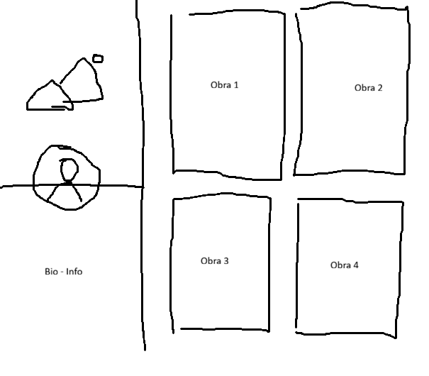
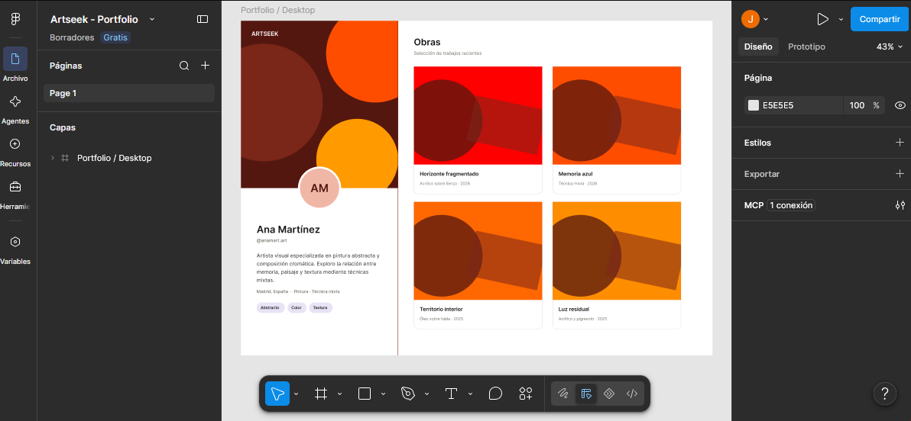

# Artseek: a web application for intelligent search and discovery of visual artworks and artists

Artseek will be a web application focused on the discovery of artworks and artists through intelligent searches based on natural language and reference images. Artists will be able to create a profile with a profile picture, a header image, and a portfolio of their works. Each artwork will include information provided by the artist and will be analyzed using Artificial Intelligence to extract characteristics that allow it to be categorized and represented semantically. Clients will be able to describe the type of artwork they are looking for using natural language, provide reference images, or combine both methods. The system will analyze the query and retrieve the artworks with the highest similarity to it, also displaying the corresponding artists. Artists will also have access to the search system, allowing them to use Artseek to discover other artworks and artists. The application is conceived as a discovery platform that combines textual and visual information to facilitate searches that would be difficult to express using traditional filters.

> **Current status:** The functional and technical objectives have been defined and development has started, but the application is not yet functional. The designs and decisions described in this documentation represent the planned scope and may evolve during development.

## Screen Sketches

The first conceived screen was the Artist Portfolio one. A first approach was made free hand with paint. Then a higher prototype was self-made in Figma for this screen. This high level prototype consists the final result of the draft for the Artist Portfolio page and was the one later used for creating the rest of screens with Artificial Intelligence in an iterative manner (see more about this in [`AI_USAGE.md`](docs/AI_USAGE.md)).

### First skecth of Artist Portfolio page:

### Figma self-made Artist Portfolio screen:

## Documentation

- [State of the Art](docs/state-of-the-art.md)
- [Objectives](docs/objectives.md)
- [Methodology](docs/methodology.md)
- [Detailed Features](docs/detailed-features.md)
- [Analysis](docs/analysis.md)
- [Progress Tracking](docs/tracking.md)
- [Authors](docs/authors.md)
- [Development Guide](docs/development-guide.md)
- [Use of AI Tools](#use-of-ai-tools)
- [Changelog](CHANGELOG.md)

## Use of AI Tools

During the project definition phase, Artificial Intelligence tools have been used to support research, analysis, and documentation writing.

In particular, **OpenAI Codex** has been used as a support tool to:

- Research concepts related to semantic and multimodal search.
- Analyze potential application functionalities.
- Organize and structure requirements.
- Propose architecture and technology alternatives.
- Review the definition of entities and relationships.
- Create and review the initial project documentation.

The final decisions regarding the objectives, scope, functionalities, architecture, and technologies are the responsibility of the student and will be reviewed throughout the different phases of the Bachelor's Degree Final Project.

The use of Artificial Intelligence tools as part of the development of Artseek will be documented throughout the project, distinguishing between work carried out directly by the student and work performed with the assistance of these tools, and will be recorded in the [`AI_USAGE.md`](docs/AI_USAGE.md) file in the `docs` directory.
