# Analysis

## Screens and navigation

Artseek's navigation will be organized around three main functionalities:

1. Profile and portfolio management.
2. Discovery of artists and artworks.
3. Intelligent search using text and images.

The main planned screens are:

| Screen | User type | Description | Accessible pages |
| --- | --- | --- | --- |
| Home/Landing | Anonymous user | Artseek's main page and entry point to search. | Search, artists, registration, login, and profile. |
| Registration | Anonymous user | Creation of a new account. | Login and home. |
| Login | Anonymous user | User authentication. | Registration and home. |
| Intelligent search | Registered user | Allows users to enter text, reference images, or both. | Results, home. |
| Intelligent search results | Registered user | Displays artworks and artists ordered by relevance. | Artwork details and artist profile. |
| Artist search | Anonymous user | Allows users to locate artists directly. | Artist profile. |
| Artist profile | Anonymous user | Displays the artist's public information and portfolio. | Artwork details. |
| Artwork details | Anonymous user | Displays an artwork, its information, and the artist who created it. | Artist profile and search results. |
| Own profile | Registered user | Allows users to view their account information. | Profile editing and, for artists, portfolio. |
| Profile editing | Registered user | Allows users to modify their profile information. | Own profile. |
| Artwork creation | Registered user | Form for publishing a new artwork. | Profile, portfolio, and artwork details. |
| Artwork editing | Registered user | Modification of an existing artwork. | Profile and artwork details. |

## Application Screens Drafts

### Home/Landing

Introduces and provides entry points for exploring creative disciplines.

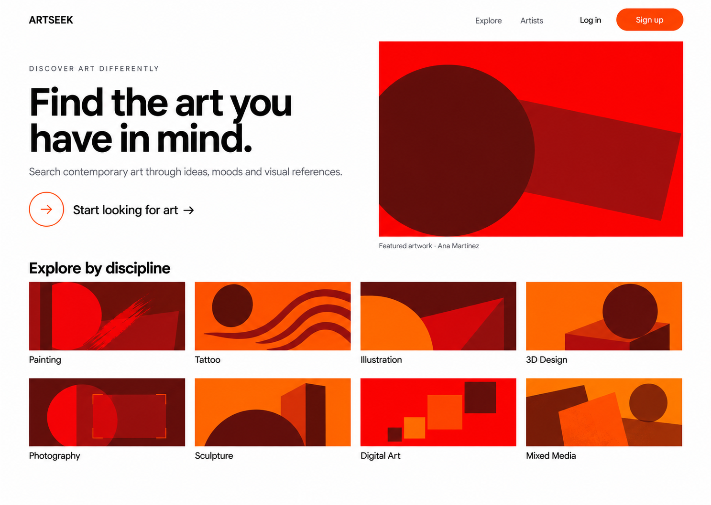

### Intelligent Search

Allows users to search for artwork using text, a reference image, or both.

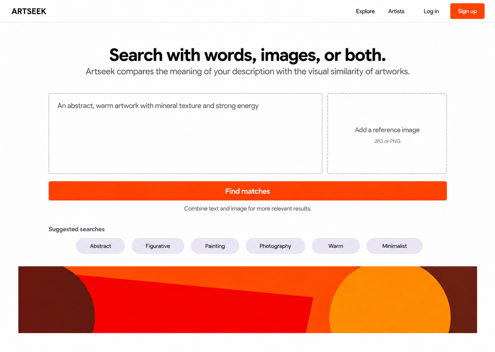

### INtelligent Search Results

Displays artworks ranked by their affinity with the user’s search.

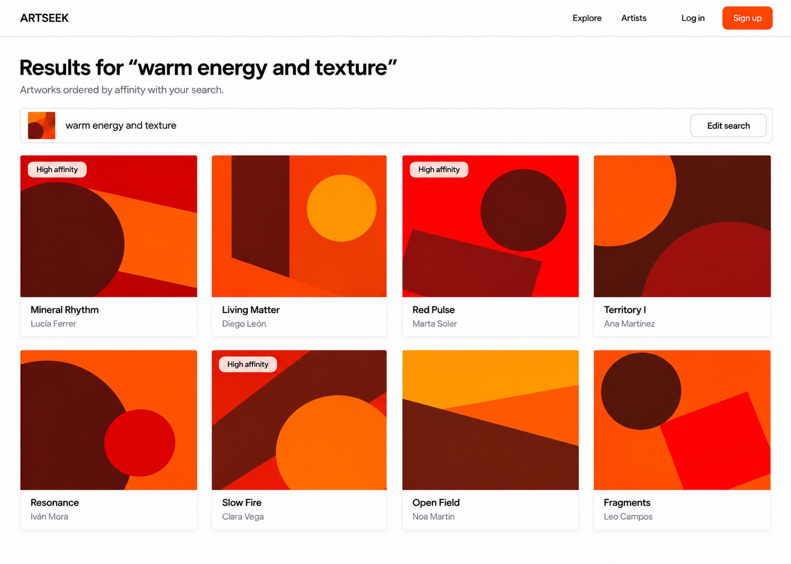

### Artist Search

Combines artist search controls and matching artist profiles on one page.

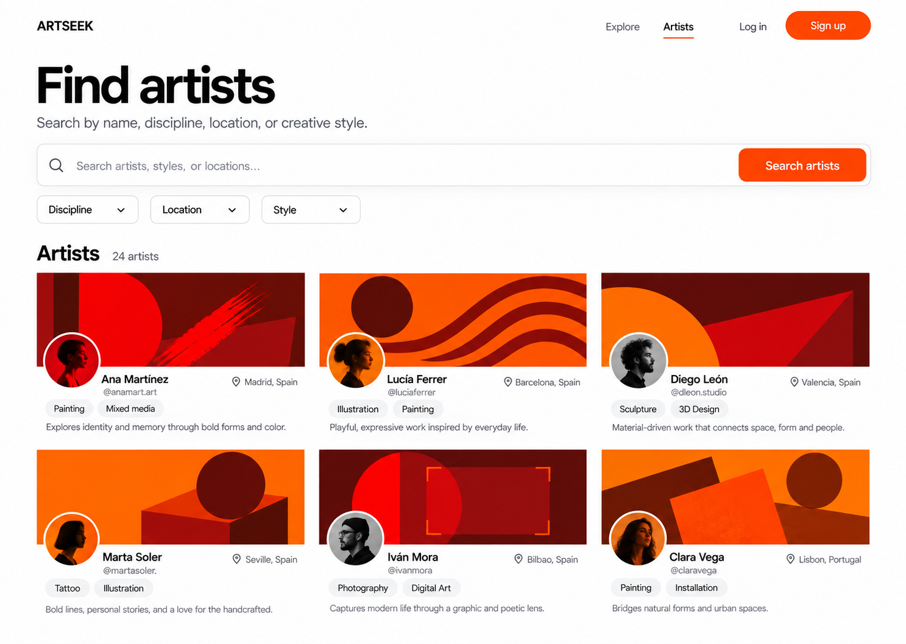

### Artist Profile

Shows an artist’s public information and portfolio.

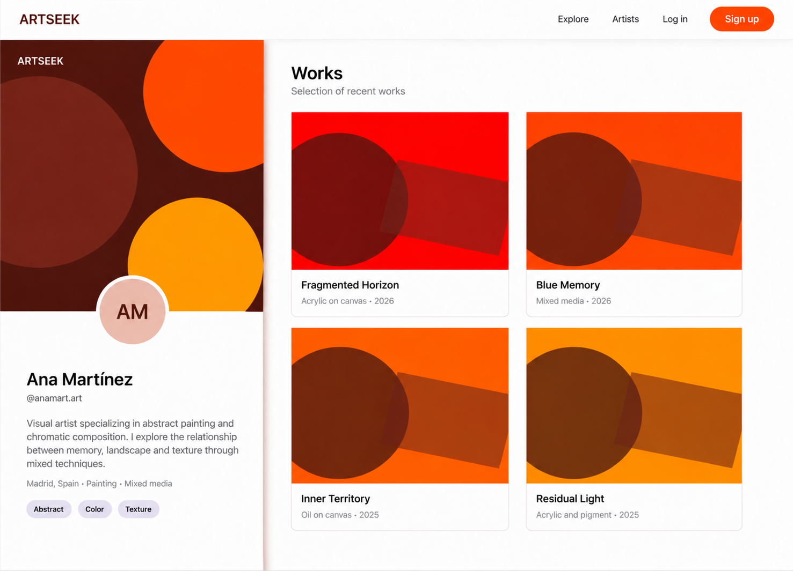

### Client Profile

Shows a client profile with an option to activate an artist portfolio.


### Artwork Focus

Presents an enlarged artwork preview within the artist’s portfolio.

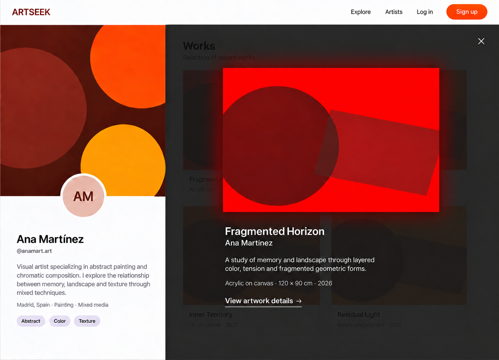

### Artwork Detail

Provides a dedicated view of an artwork, including its description, characteristics, categories, and AI analysis.

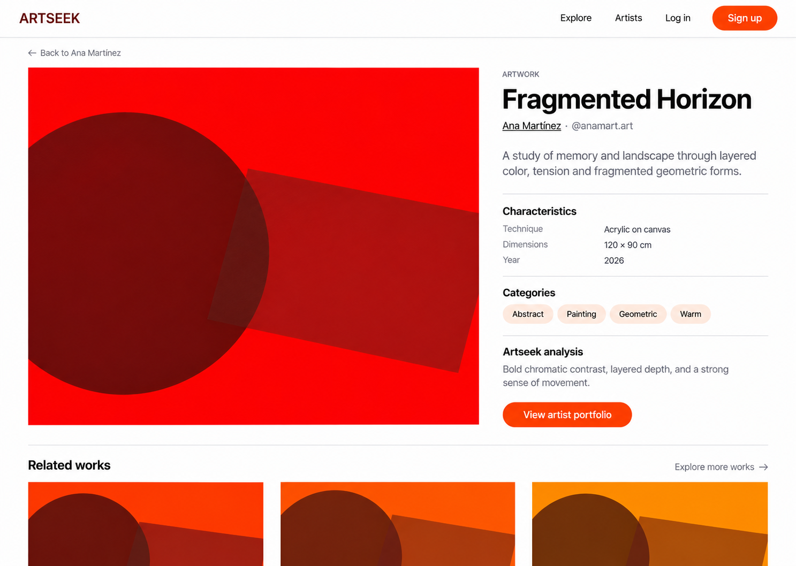

### Owner Artwork Detail

Shows the artwork detail view with editing controls available to its owner.


### Edit Artwork

Allows the owner to update artwork information while keeping AI-generated analysis read-only.

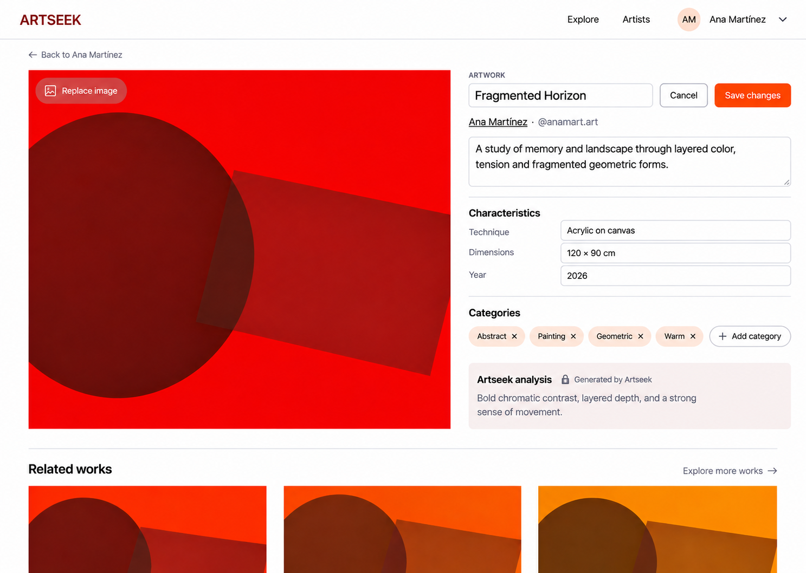

### Account Details

Displays the signed-in user’s personal and account information.

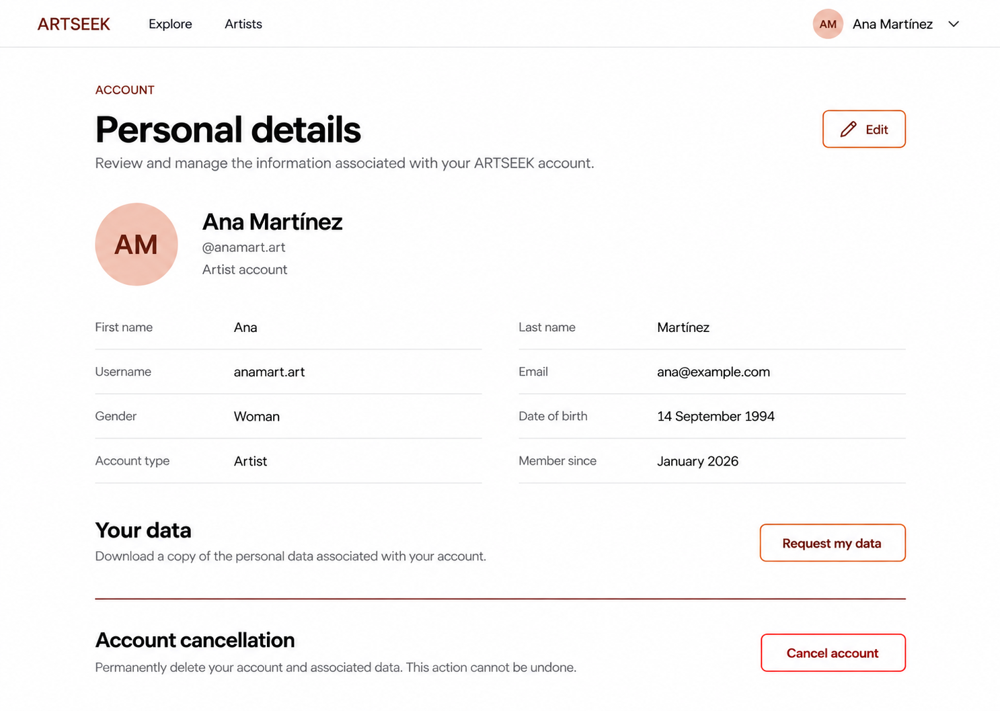

### Edit Account Details

Allows users to update their personal information and profile image.

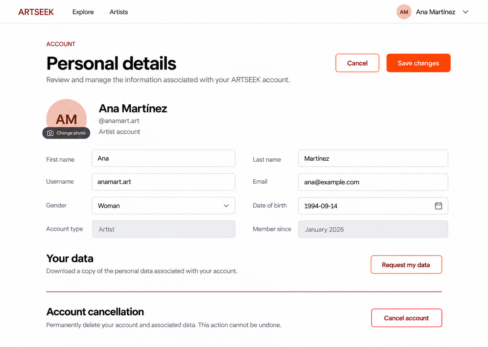

### Log In

Provides a focused authentication form for returning users.

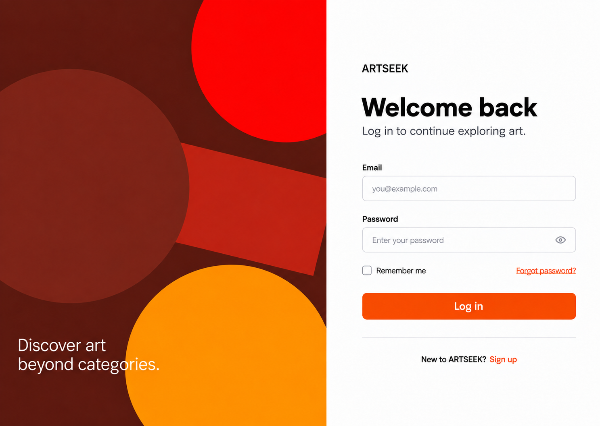

### Sign Up

Collects the information required to create a client or artist account.

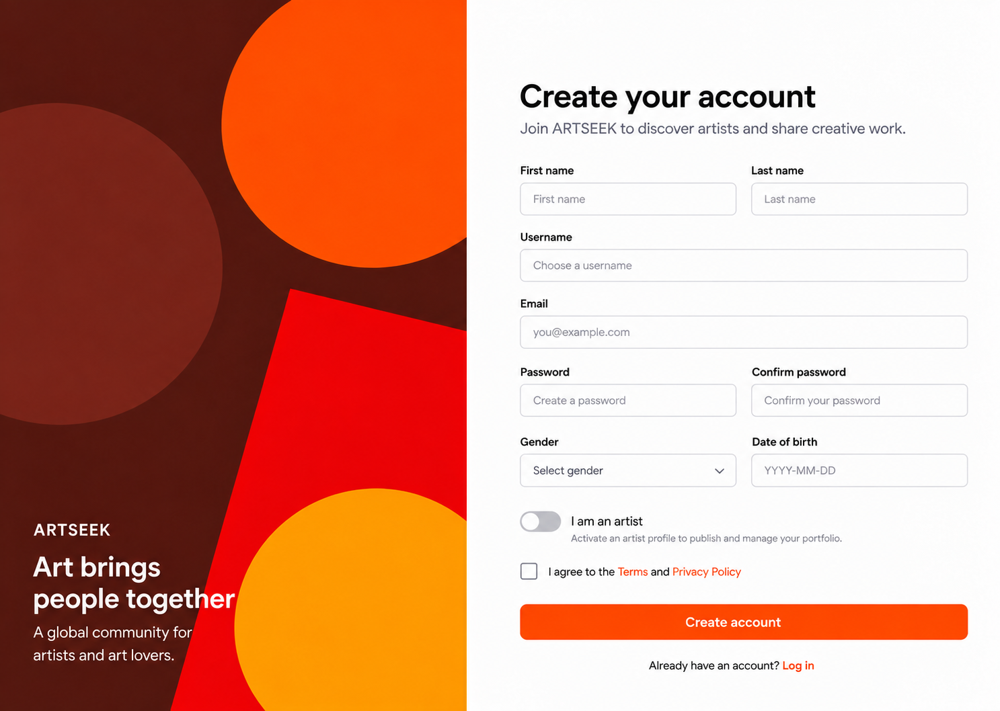

### Navigation Diagram

Arrow colors indicate the minimum role required for each transition. Administrators inherit the transitions available to anonymous and registered users; dashed red arrows identify administrator-only moderation overrides.

[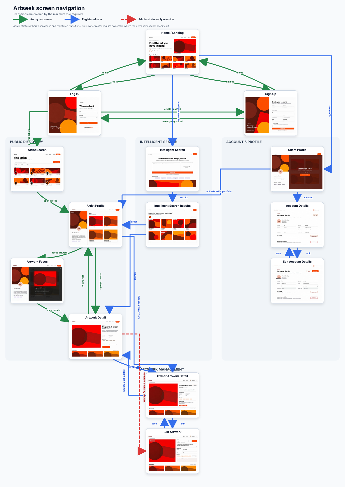](navigation-diagram.svg)


---

## Entities

The main Entities in Artseek domain are the following:


```mermaid
classDiagram

    class User {
        +Long id
        +String username
        +String email
        +String passwordHash
        +String displayName
        +String bio
        +String profileImage
        +String headerImage
        +Boolean isArtist
        +LocalDateTime createdAt
        +LocalDateTime updatedAt
    }

    class Portfolio {
        +Long id
        +String title
        +String description
        +Boolean isPublic
        +String layoutPreference
    }

    class Artwork {
        +Long id
        +String title
        +String description
        +LocalDateTime createdAt
        +LocalDateTime updatedAt
    }

    class Category {
        +Long id
        +String name
        +String type
    }

    class SearchQuery {
        +Long id
        +String naturalLanguageText
        +String referenceImageUrl
        +SearchType searchType
        +LocalDateTime executedAt
    }

    class SearchType {
        <<Enumeration>>
        TEXT
        VISUAL
        MULTIMODAL
    }

    class AIAnalysis {
        <<Value Object>>
        +String description
        +String characteristics
        +String model
        +LocalDateTime analyzedAt
    }

    class Embedding {
        <<Value Object>>
        +String type
        +String model
        +Vector vector
        +LocalDateTime generatedAt
    }

    User "1" --> "0..1" Portfolio : owns
    Portfolio "1" --> "0..*" Artwork : contains
    User "1" --> "0..*" SearchQuery : executes
    Artwork "0..*" --> "0..*" Category : belongs to


    SearchQuery *--"1..1"SearchType
    Artwork *-- "0..1" AIAnalysis : contains
    Artwork *-- "0..*" Embedding : contains
 ```

Entities in Artseek represent objects with a distinct identity that persists over time, even if their attributes change.

**User**: This is the primary actor in the system. A user has a unique identity, personal information (such as username, email, and display name), and profile customization data (profile and header images). Users can be either clients or artists, distinguished by the isArtist flag.

**Portfolio**: This entity serves as a container for an artist's creative output. Instead of artworks being directly attached to a user, they are grouped within a portfolio. This allows the artist to manage the collection as a whole (e.g., setting the entire portfolio as public or private, or defining layout preferences). Furthermore, this design is built with scalability in mind: while an artist currently manages a single portfolio, this structure easily supports a future feature where an artist could create multiple distinct portfolios to separate different collections (e.g., "Digital Art" vs. "Traditional Painting").

**Artwork**: The core content entity of the platform. It represents a single creative piece, holding its own identity, title, description, and timestamps.

**Category**: Categories are used to classify artworks (e.g., disciplines, techniques, or styles). A category is an entity because it has a shared, independent lifecycle; an administrator can create, rename, or delete a category globally, and these changes must be reflected across all artworks that reference it.

**SearchQuery**: To leverage the intelligent nature of the platform, user searches are modeled as persistent entities rather than ephemeral actions. A SearchQuery records the specific input from the user (the natural language text and/or the URL of a reference image), the type of search executed (defined by the SearchType enumeration: textual, visual, or multimodal), and the exact timestamp. This allows the platform to offer users a history of their past searches and provides valuable analytical data to calibrate and improve the semantic search algorithm over time.

### Value Objects
Unlike Entities, Value Objects are defined entirely by their attributes and do not possess a unique identifier. They are immutable descriptions that only make sense within the context of the entity that owns them.

**AIAnalysis**: When an artwork is uploaded, the Artificial Intelligence model generates a description and extracts characteristics. This result is a Value Object. It has no independent existence; it is simply a descriptive trait embedded within the Artwork. If the artwork is re-analyzed, the old analysis is entirely replaced by the new one.

**Embedding**: This represents the mathematical, semantic vector generated from the artwork's visual or textual data. Like the AI analysis, an embedding is just a complex attribute of the Artwork used for similarity calculations. It is bound to the artwork via strict composition.

---


## User permissions

Initially, three main types of users are considered:

- **Anonymous user**: user not registered in the application

- **Registered user**: user registered in the application. They may be a client or an artist.

- **Administrator**: administrator user


| Action | Anonymous user | Registered user | Administrator |
| --- | :---: | :---: | :---: |
| View public content | Yes | Yes | Yes |
| Register | Yes | — | — |
| Log in | Yes | Yes | Yes |
| Manage own profile | No | Yes | Yes |
| View profiles | Yes | Yes | Yes |
| Search for artists | Yes | Yes | Yes |
| Access artwork details | Yes | Yes | Yes |
| Perform searches using text | No | Yes | Yes |
| Perform searches using images | No | Yes | Yes |
| Perform multimodal searches | No | Yes | Yes |
| Activate artist profile | No | Yes | — |
| Create artworks | No | Only if they are an artist | Yes |
| Modify own artworks | No | Only if they are an artist and the owner | Yes |
| Delete own artworks | No | Only if they are an artist and the owner | Yes |
| Manage portfolio | No | Only if they are an artist and the owner | Yes |
| View AI analysis | Yes | Yes | Yes |
| Manage own categories | No | Only if they are an artist and the owner | Yes |

---

## Images

Artseek will use images associated with different entities and functionalities.

The main ones will be:

- User profile image.
- Profile header image.
- Images of the artworks.
- Reference images used during searches.

| Entity / functionality | Images | Use |
| --- | --- | --- |
| User | One profile image | Visual identification of the user. |
| User | One header image | Profile customization. |
| Artwork | One or more images | Visual representation of the artwork. |
| Search | One reference image | Input for visual or multimodal searches. |

Artwork images must be usable as part of the process of generating semantic representations and similarity-based search.

---

## Charts

Charts do not constitute a main functionality of Artseek, since the primary purpose of the application is the discovery of artworks and artists.

However, charts could be incorporated to display information related to portfolios or the operation of the system.

Some possibilities are:

- **Bar chart:** number of artworks per category within a portfolio.

- **Pie chart:** distribution of a portfolio according to styles or techniques.

- **Line chart:** evolution over time of published artworks or interactions with the portfolio.

These functionalities will have a secondary priority and will only be implemented if they are relevant to the final scope of the project.

---

## Complementary technology

The complementary technology will be mainly related to Artificial Intelligence and semantic search.

The selection will take into account for the AI model:

- Ability to analyze images.
- Ability to work with text.
- Possibility of obtaining embeddings.
- Compatibility with multimodal searches.
- Quality of the results.
- Cost.
- Performance.
- Ease of integration.
- License and terms of use.

The planned technology architecture is:

| Technology | Use |
| --- | --- |
| PostgreSQL | Persistence of the application's entities. |
| pgvector | Storage and search of vector representations. |
| Docker | Containerization of the application. |
| Docker Compose | Orchestration of the local development environment. |
| Spring Security | Authentication and authorization. |
| JWT | Authentication management using tokens. |
| GitHub Actions | Continuous integration and quality controls. |
| AI service/model | Image analysis and generation of semantic information. |

The specific technology used for the Artificial Intelligence models will be selected during the technical analysis phase.

---

## Advanced algorithm or query

The most relevant technical functionality of Artseek will be a **multimodal semantic search system based on embeddings**.

Each artwork will have an associated semantic representation obtained from the information available about it.

Conceptually:

```text
                         ARTWORK
                           │
             ┌─────────────┴─────────────┐
             │                           │
        Textual Data                   Image
         Artist + AI                     │
             │                           │
             ▼                           ▼
      Textual Embedding            Visual Embedding
             │                           │
             └─────────────┬─────────────┘
                           │
                           ▼
                    Artwork semantic
                     representation
                           │
                           ▼
                   Vectorial database
```

A natural language query will follow a similar process:

```text
   User query
        │
        ▼
  Text processing
        │
        ▼
  Query embedding
        │
        ▼
 Similarity search
        │
        ▼
 Candidate artworks
        │
        ▼
 Ranking by relevance
        │
        ▼
      Results
```

In an image-based search:

```text
  Reference image
        │
        ▼
  Image analysis
        │
        ▼
  Visual embedding
        │
        ▼
  Similarity search
        │
        ▼
  Candidate artworks
        │
        ▼
 Ranking by relevance
        │
        ▼
     Results
```

In a multimodad search both sources will be combined

```text
                      Query
                   /        \
                  /          \
               Text          Image
                 │              │
                 ▼              ▼
            Textual          Visual
           Embedding        Embedding
                 │              │
                 └──────┬───────┘
                        ▼
                  Query semantic
                  representation
                        │
                        ▼
                 Vectorial search
                        │
                        ▼
                     Ranking
                        │
                        ▼
                     Results
```


A first approach to calculating relevance will be to combine textual and visual similarity using a weighted function:

```text
score =
    α × textualSimilarity +
    β × visualSimilarity
```

where `α` and `β` represent the relative weight of each component.

These weights will be determined experimentally during development.

The similarity between vector representations may be calculated using **cosine similarity**:

```text
cos(A, B) = (A · B) / (||A|| × ||B||)
```

The search should initially retrieve a set of candidate artworks and subsequently rank them according to the score obtained.

The objective will be for the top positions to correspond to the artworks with the highest semantic and visual similarity to the query performed.

During development, the quality of the results will be evaluated using different types of queries and sets of artworks to assess the behavior of the system.
