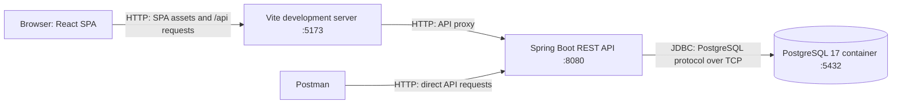
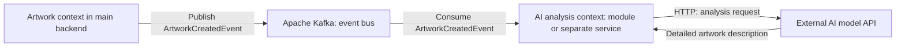

# Development Guide

This guide describes the development environment and implementation available at the end of Phase 2: backend health checks, category persistence and queries, and frontend pages that consume those queries. It also records the planned AI artwork-analysis component, its Kafka event flow and the two deployment options still under consideration. The full application described in the [detailed features](detailed-features.md) is still under development. Commands below use PowerShell; each example identifies its working directory.

## Index

- [Introduction](#introduction)
- [Technologies](#technologies)
- [Tools](#tools)
- [Architecture](#architecture)
- [Quality control](#quality-control)
- [Development process](#development-process)
- [Running and editing the code](#running-and-editing-the-code)
- [Running tests](#running-tests)
- [Creating a release](#creating-a-release)

## Introduction

Artseek is a **Single-Page Application (SPA)**: the browser loads the React application and React Router changes views without requesting a new HTML document for every navigation. The client retrieves data over HTTP from a Java and Spring Boot REST API, which persists categories in PostgreSQL. During development, Vite serves the frontend on port 5173, Spring Boot runs on port 8080, and PostgreSQL runs in a Docker container exposed on port 5432.

The planned architecture also includes a separate context for AI artwork analysis, which will call an external AI model API to generate a detailed description for semantic search. When an artwork is created, the artwork context will publish an `ArtworkCreatedEvent` through Apache Kafka. The analysis context will consume that event. Whether analysis runs as a module within the backend or as an independently deployed service remains undecided; both options retain Kafka. This event flow has not been implemented yet.

| Aspect | Current implementation |
| --- | --- |
| Type | Web SPA and REST API, with one backend application and one relational database. |
| Technologies | React, TypeScript, React Router, TanStack Query, React-Bootstrap, Bootstrap and Tailwind CSS; Java, Spring Boot, Spring Data JPA and PostgreSQL. |
| Tools | Visual Studio Code with Spring Boot extensions, IntelliJ IDEA, Git, GitHub, Maven, Node.js, pnpm, Vite, Docker, Postman and OpenAPI tooling. |
| Quality control | Backend unit, integration and HTTP system tests; frontend TypeScript checks and production builds; GitHub Actions and required checks before merging. SonarQube Cloud static analysis, backend JaCoCo coverage and a blocking quality gate are planned additions to PR quality assurance. |
| Deployment | Local frontend and backend processes, with PostgreSQL 17 in a Docker container. Application container images and a production deployment have not been configured. |
| Development process | Iterative and incremental work organized through GitHub issues, branches and pull requests, with automated integration checks. |

## Technologies

The backend dependencies are declared in [`backend/pom.xml`](../backend/pom.xml). Frontend dependencies are declared in [`frontend/package.json`](../frontend/package.json), with resolved versions recorded in [`pnpm-lock.yaml`](../frontend/pnpm-lock.yaml).

| Technology | Use in Artseek |
| --- | --- |
| [Java](https://dev.java/) 25 LTS and [Spring Boot](https://spring.io/projects/spring-boot) 4.1.1 | Implement the REST API, dependency injection, application startup and transaction management. The Java version file currently specifies `25.0.4.1`. |
| [Spring Web MVC](https://docs.spring.io/spring-framework/reference/web/webmvc.html) | Maps HTTP requests to controllers and serializes application DTOs as JSON. |
| [Spring Data JPA](https://spring.io/projects/spring-data-jpa) and [Hibernate ORM](https://hibernate.org/orm/) | Implement persistence adapters and map the `Category` entity to PostgreSQL. |
| [PostgreSQL](https://www.postgresql.org/docs/17/) 17 | Stores categories in the local development database. Hibernate currently updates the schema through `spring.jpa.hibernate.ddl-auto=update`. |
| [React](https://react.dev/) 19.3.0 and [TypeScript](https://www.typescriptlang.org/) 5.9.3 | Define the frontend components and typed API contracts. TypeScript is compiled to JavaScript for the browser. |
| [React Router](https://reactrouter.com/) 8.4.0 | Defines the home, category and health routes. Framework mode is configured with `ssr: false`, so the application runs as a client SPA. |
| [TanStack Query](https://tanstack.com/query/latest/docs/framework/react/overview) 5.104.2 | Provides the shared server-data cache, query keys, request deduplication, cancellation support and retries. Client loaders use the cache; React Router coordinates route loading and errors. |
| [React-Bootstrap](https://react-bootstrap.github.io/) 2.10.10, [Bootstrap](https://getbootstrap.com/) 5.3.8 and [Tailwind CSS](https://tailwindcss.com/) 4.3.3 | Provide interface components and styling. Bootstrap's stylesheet is imported once in the application root. |

[Apache Kafka](https://kafka.apache.org/intro) is selected for the planned asynchronous communication between the artwork and AI analysis contexts in both deployment options. Kafka and the analysis component are not yet configured in the repository. Analysis will call an external AI model API; the provider, model and deployment configuration remain to be defined.

## Tools

| Tool | Use in the project |
| --- | --- |
| [Visual Studio Code](https://code.visualstudio.com/) and its [Spring Boot extensions](https://marketplace.visualstudio.com/items?itemName=vmware.vscode-boot-dev-pack) | Frontend development and a view of the whole repository, with Spring Boot support available in the editor. |
| [IntelliJ IDEA](https://www.jetbrains.com/idea/) | Backend development, Java navigation, Maven integration, test execution and debugging. |
| [Git](https://git-scm.com/) and [GitHub](https://docs.github.com/) | Version control, issues, pull requests, project tracking and repository rules. |
| [Apache Maven](https://maven.apache.org/) 3.9+ | Resolves backend dependencies, compiles Java, runs tests and packages the server. Maven is installed locally; the repository does not contain a Maven Wrapper. |
| [Node.js](https://nodejs.org/) and [pnpm](https://pnpm.io/) | Run the frontend development tools and install dependencies. [`.nvmrc`](../.nvmrc) specifies Node.js `24.19.0`, and `packageManager` specifies pnpm `10.17.1`. |
| [Vite](https://vite.dev/) 8.3.1 | Serves the frontend during development, proxies API requests and builds the browser assets through React Router. |
| [Docker](https://docs.docker.com/) | Runs the PostgreSQL development container using a plain `docker run` command and a named volume. |
| [Postman](https://learning.postman.com/docs/getting-started/overview/) | Sends requests to the REST API. The [project collection](api/artseek.postman_collection.json) contains examples for every currently implemented application endpoint. |
| [springdoc-openapi](https://springdoc.org/) and [OpenAPI Generator](https://openapi-generator.tech/) | Expose the OpenAPI contract and Swagger UI, export the YAML contract, and generate the HTML API reference. |
| [GitHub Actions](https://docs.github.com/en/actions) | Runs backend tests and frontend checks on branch pushes, pull requests and integration into `main`. |
| [SonarQube Cloud](https://docs.sonarsource.com/sonarqube-cloud/) (formerly SonarCloud; planned) | Will analyze backend Java and frontend TypeScript/JavaScript in the PR quality-assurance workflow, report findings on pull requests and enforce a blocking quality gate. |
| [JaCoCo](https://www.jacoco.org/jacoco/) (planned) | Will measure backend test coverage and generate HTML and XML reports, with the XML report imported into SonarQube Cloud. |

## Architecture

### Current deployment



Vite, Spring Boot and PostgreSQL are independent processes. The React application executes in the browser. The [`Vite configuration`](../frontend/vite.config.js) forwards `/api` requests to the backend, keeping frontend requests relative to the browser origin. The backend also configures CORS for `http://localhost:5173` through [`WebConfig`](../backend/src/main/java/com/artseek/infrastructure/config/WebConfig.java).

Only PostgreSQL is containerized in the current environment. Backend packaging produces a Spring Boot JAR, and the frontend build produces static SPA assets under `frontend/build/client`. The repository currently has no Dockerfile, Docker Compose configuration or production hosting configuration for these application components. The manual PostgreSQL `docker run` command will later be replaced by a Docker Compose configuration.

### Planned AI artwork analysis: deployment undecided

Artwork analysis will have a separate context and communicate through Kafka. Its deployment boundary is still undecided. The following two options are being considered:

| Option | Deployment and communication | Main tradeoff |
| --- | --- | --- |
| Separate module with Kafka | The analysis module runs within the same Spring Boot backend process as the artwork context. It consumes Kafka events and calls an external AI model API. Kafka runs as a separate broker process. | Keeps one backend deployment while establishing a messaging contract that can be retained if analysis is extracted later. Kafka adds broker operation, serialization and consumer configuration even while both contexts share a process, which may be more infrastructure than this initial deployment needs. |
| Separate service with Kafka | The analysis context runs in its own process and can be deployed independently. The artwork backend publishes events through Kafka, and the analysis service consumes them and calls an external AI model API. | Enables independent deployment and scaling of analysis, with an additional service to configure, operate and test. |

In the module option, Kafka is retained deliberately to make communication between contexts independent of Spring's in-process application-event mechanism. Keeping the event contracts and Kafka adapters stable can reduce changes to messaging when extracting the module into a service. Extraction would still require separating runtime dependencies, data access, configuration and deployment; Kafka alone does not make that transition automatic. A design using Spring application events could also preserve its analysis logic behind interfaces, with its transport integration adapted during extraction.

The common planned flow is:



1. An artwork is created in the main application.
2. The main backend publishes an `ArtworkCreatedEvent` to Kafka.
3. The analysis context consumes that event and requests artwork analysis from an external AI model API.
4. The API returns a detailed description to enrich the artwork's semantic-search information.

Kafka carries events between the two contexts in either deployment option. The Spring mediator described below routes commands and queries within the main backend process; it serves a different role from the Kafka messaging boundary.

This is an architecture outline. Artwork creation, Kafka event publication and consumption, and the analysis component are not implemented in the current repository. The event payload, image-access mechanism and result persistence flow still need to be specified. Transactional outbox, idempotency and other delivery/error-handling details will be considered during implementation. Neither deployment option has been selected.

### Backend structure

The backend separates **domain**, **application** and **infrastructure** responsibilities, following DDD Lite and hexagonal architecture with a CQRS application layer:

```text
REST controller
  -> Mediator.send(query)
    -> Query handler
      -> Domain repository port
        -> Repository adapter
          -> Spring Data JPA -> PostgreSQL
```

- **Domain:** `Category`, the `CategoryType` enum, validation exceptions and the `CategoryRepository` port. Entities enforce their own invariants and use JPA annotations to avoid duplicating domain and persistence models.
- **Application:** Query records, query handlers and DTOs, organized by feature. Handlers normalize and validate input through domain types, call repository ports and map results into immutable DTO lists. Read handlers use `@Transactional(readOnly = true)`.
- **Infrastructure:** REST controllers, the Spring mediator implementation, JPA repository adapters, CORS configuration and local sample-data initialization.

[`SpringMediator`](../backend/src/main/java/com/artseek/infrastructure/mediator/SpringMediator.java) discovers injected command and query handlers, registers them by request class, and routes requests to the corresponding handler. It rejects duplicate registrations and reports missing handlers. The current category operations are synchronous queries against the same PostgreSQL database. Command interfaces and dispatch support exist, but no category write endpoint is exposed yet.

Controllers depend on the application `Mediator` contract. `FindUsedCategoryTypesQueryHandler` and `FindCategoriesByTypeQueryHandler` depend on the domain repository port; `CategoryRepositoryAdapter` implements that port using Spring Data JPA. The API returns `CategoryDTO` and `CategoryTypeDTO` records, keeping domain entities inside the backend.

[`DatabaseInitializer`](../backend/src/main/java/com/artseek/infrastructure/bootstrap/DatabaseInitializer.java) runs only with the `local` Spring profile. It inserts three painting categories—Surrealism, Impressionism and Realism—and two tattoo categories—Blackwork and Watercolor. It checks each name/type pair before inserting it, so restarting with existing sample rows does not insert them again.

### Frontend structure

The frontend groups backend communication by feature under `app/features/`. Route data follows this flow:

```text
clientLoader -> shared QueryClient + feature query options -> API function -> REST API
clientLoader result -> loaderData -> route component
```

The `categories` feature contains HTTP functions in `api/`, query keys and options factories in `queries/`, and named API contracts in `model/`. Group related operations by resource: `category-type-api.ts` and `category-type-queries.ts` contain category-type operations; category types remain part of the categories feature. DTOs such as `CategoryTypeDTO` have their own model files and use simple TypeScript types, not classes. The `backend-status` feature checks backend availability. API functions use `fetch`, pass the query's abort signal, reject unsuccessful HTTP responses and validate category response shapes.

Export one browser-lifetime `queryClient` from `app/lib/query-client.ts`. Each route's `clientLoader` imports that instance, awaits `queryClient.query(...)` with feature query options, and returns data rendered through typed `Route.ComponentProps.loaderData`. Do not create a client per route or add a query hook just to read the same data again. Path parameters such as `params.categoryType` are loader inputs and must also be included in the query key.

Category and used-category-type options use `staleTime: 60_000`; health uses `staleTime: 0` to check availability on each visit. All three use `retry: 1`. Loaders can execute again during navigation while reusing a fresh cache entry without another HTTP request. Missing, stale or invalidated data is fetched when the loader next queries it. Cache entries remain subject to garbage collection; freshness does not guarantee indefinite retention.

`loaderData` is a snapshot, not a cache subscription. This design provides cache reuse, deduplication, retries and targeted invalidation, but does not automatically refresh an open page when the cache changes. Initial loading uses the root `HydrateFallback`; pending navigations use root-level `useNavigation` feedback. Unexpected loading errors reach the single `root.tsx` error boundary rather than route-specific boundaries. The health loader handles unavailable-backend failures explicitly, returning `backendStatus: null` for the health page's status message. Successful empty category responses render empty states.

Use `useActionState` for straightforward form submissions and validation results, calling feature API functions from the action. After a successful write, invalidate affected keys on the shared client and revalidate the route or navigate when its displayed loader data must be refreshed. Invalidation alone does not replace a rendered snapshot.

Add custom query hooks only for reactive component needs such as live cache updates, polling or component-driven queries; add mutation hooks when writes need capabilities such as optimistic updates or coordinated mutation state. These hooks belong in the feature's optional `hooks/` folder and reuse its query options. When hooks are needed, a `QueryClientProvider` must expose the **same imported client instance used by loaders**, not a second client. Loaders access the client directly, not through React context; loader-only queries do not require the provider. Keep Zustand reserved for genuinely shared browser-only state and do not create a store for the current pages.

The [frontend architecture standard](../frontend/AGENTS.md) contains the full responsibilities and naming rules. The component-library choice and existing styles are unchanged by this data-loading design.

[`app/routes.ts`](../frontend/app/routes.ts) defines `/` for used category types, `/category/:categoryType` for categories of a selected type, and `/health` for backend availability. React Router links preserve SPA navigation.

### REST API

The [generated HTML API reference](https://raw.githack.com/codeurjc-students/2026-Artseek/main/docs/api/api-docs.html) is served through raw.githack.com. Its sources are the [HTML file](api/api-docs.html) and [OpenAPI YAML contract](api/api-docs.yaml). With the backend running, use [Swagger UI](http://localhost:8080/swagger-ui.html) or the [live YAML contract](http://localhost:8080/v3/api-docs.yaml).

| Operation | Behavior |
| --- | --- |
| `GET /api/health` | Returns HTTP `200` with an empty body when the backend responds. |
| `GET /api/1.0/categories/types/used` | Returns distinct stored category types ordered by type, for example `[{"value":"painting"},{"value":"tattoo"}]`. An empty database returns `[]`. |
| `GET /api/1.0/categories/{type}` | Returns categories with `id`, `name` and `type`. Supported types are `painting` and `tattoo`; parsing ignores case and surrounding whitespace. A supported type with no categories returns `[]`. An unsupported type returns HTTP `400` with an empty body. Category order is not specified. |

The generated YAML currently lists successful responses; the invalid-type `400` behavior is implemented in the controller and covered by its tests and the Postman examples. The health endpoint is an HTTP availability check, rather than a report of individual dependency status.

## Quality control

### Automated checks and traceability

The implemented technical features are traceable to GitHub issues. The functional feature tables do not yet assign individual requirement numbers, so the following references use the existing issue identifiers.

| Area and issue | Checks and tools | Behavior verified |
| --- | --- | --- |
| Health endpoint, [P2-04 / #5](https://github.com/codeurjc-students/2026-Artseek/issues/5) | `HealthControllerUnitTests` with a Spring MVC test slice; `HealthEndpointSystemTests` with a running HTTP server and `RestTestClient`. | HTTP success through both controller-level and real-server requests. |
| Category domain and persistence, [P2-07 / #10](https://github.com/codeurjc-students/2026-Artseek/issues/10) | `CategoryUnitTests`, repository adapter unit/integration tests and initializer integration tests. | Entity invariants, enum conversion, repository delegation, generated IDs, enum storage, filtering, distinct used types and insertion of sample categories. |
| Category queries and API, [P2-07 / #10](https://github.com/codeurjc-students/2026-Artseek/issues/10) and [CQRS / #19](https://github.com/codeurjc-students/2026-Artseek/issues/19) | Query-handler unit/integration tests and category controller unit/integration tests. | Query registration, input validation, DTO mapping, immutable output where asserted, database-backed filtering, routing, JSON and invalid-type errors. |
| Mediator, [#19](https://github.com/codeurjc-students/2026-Artseek/issues/19) | `SpringMediatorUnitTests`. | Query and command dispatch, empty registries, duplicate registrations and missing handlers. |
| Application startup | `ArtseekApplicationIntegrationTests`. | Spring application-context startup with test configuration. |
| Frontend, [P2-08 / #11](https://github.com/codeurjc-students/2026-Artseek/issues/11) | TypeScript checks and React Router/Vite production builds. | Route type generation, TypeScript compatibility and successful compilation. Automated frontend behavior tests have not been added yet. |

Backend tests use [JUnit](https://junit.org/), [Mockito](https://site.mockito.org/), [AssertJ](https://assertj.github.io/doc/) and [Spring Boot test support](https://docs.spring.io/spring-boot/reference/testing/index.html). Unit tests isolate domain/application classes or the MVC boundary. Integration tests exercise real Spring components and persistence; the system test starts an actual HTTP server on a random port.

[`backend/src/test/resources/application.properties`](../backend/src/test/resources/application.properties) selects an in-memory [H2](https://www.h2database.com/) database in PostgreSQL compatibility mode with schema creation and removal. Tests do not require the development PostgreSQL container. JPA slice tests roll back automatically, and the full-context tests that write data use transactions. The `local` profile is not activated during ordinary test runs. H2 compatibility mode does not verify every PostgreSQL-specific behavior.

### Planned static analysis and coverage

[P2-10 / #18](https://github.com/codeurjc-students/2026-Artseek/issues/18) will extend the blocking PR quality-assurance workflow with SonarQube Cloud and backend JaCoCo coverage:

- SonarQube Cloud will statically analyze the backend Java and frontend TypeScript/JavaScript sources. Native pull-request analysis will evaluate new and modified code relative to the target branch; analysis on pushes to `main` will maintain the baseline.
- The complete backend test suite will run through Maven's `verify` lifecycle. JaCoCo will generate `backend/target/site/jacoco/index.html` and `backend/target/site/jacoco/jacoco.xml`, and SonarQube Cloud will import the XML report. Frontend coverage is outside the scope of this planned addition.
- The analysis job will wait for the quality-gate result. A failed analysis, unavailable analysis service or failed quality gate will leave the workflow unsuccessful and prevent merging through the required check.
- A **SonarQube Cloud** required check will be added to the `main` ruleset alongside **Backend test suite** and **Frontend test suite**. Submitting an analysis alone will not satisfy the planned gate.

The integration is planned and is not present in the current workflow or Maven configuration. The SonarQube Cloud project binding, analysis credentials and quality-gate conditions will be configured during implementation. No coverage percentage, threshold or successful analysis result is claimed here.

### Results and code size

The successful [quality-assurance run on `main`, 19 October 2026](https://github.com/codeurjc-students/2026-Artseek/actions/runs/39319236638), tested commit `6986a07`. Its logs, checked on 24 October 2026, report:

| Backend test category | Tests | Failures | Errors | Skipped |
| --- | ---: | ---: | ---: | ---: |
| Unit | 31 | 0 | 0 | 0 |
| Integration | 17 | 0 | 0 | 0 |
| System | 1 | 0 | 0 | 0 |
| **Total** | **49** | **0** | **0** | **0** |

The same run successfully type-checked and built the frontend. These results predate the planned SonarQube Cloud and JaCoCo integration described above. There is currently no configured coverage reporter, coverage threshold, dedicated linter or SonarQube Cloud analysis, so no coverage percentage or static-analysis quality-gate result is reported.

The following source-size snapshot was measured on 24 October 2026 at commit `93cbfda`, counting tracked files under `backend/src/main/java/` and `frontend/app/`. Physical lines include comments and blank lines; tests, configuration, generated files and dependencies are excluded.

| Source | Files | Physical lines |
| --- | ---: | ---: |
| Java | 29 | 621 |
| TypeScript (`.ts`) | 9 | 125 |
| TypeScript/React (`.tsx`) | 5 | 240 |
| CSS | 1 | 13 |
| **Total** | **44** | **999** |

## Development process

Development follows the [iterative and incremental methodology](methodology.md): scope is introduced progressively, and each change is verified before integration. GitHub issues describe expected outcomes, scope, acceptance criteria and manual verification using the [development-task template](../.github/ISSUE_TEMPLATE/development-task.md). Work is tracked through [repository issues](https://github.com/codeurjc-students/2026-Artseek/issues) and the project's [tracking documentation](tracking.md).

Changes are developed in branches and integrated into `main` through pull requests. Existing branch names include `feature/P2-09_Create_OpenAPI_documentation`, `refactor/Refactor_application_layer_into_CQRS` and `phase-2-update-project-documentation`. A pull-request description uses `Closes #<issue-number>` to associate the change with an issue and close it when merged. The history includes a branch covering both P2-05 and P2-06; the workflow does not require a separate branch for every issue.

The active ruleset for the default branch requires a pull request, disallows branch deletion and force pushes, and requires the **Backend test suite** and **Frontend test suite** checks. Required checks must pass with the branch up to date before merging. The configured approving-review count is zero. [`CHANGELOG.md`](../CHANGELOG.md) remains the designated change log at the repository root.

The planned SonarQube Cloud integration will add a third required check for static analysis and the quality gate. That check is not yet part of the current ruleset.

As of the inspected checkout on 24 October 2026, `HEAD` (`93cbfda`) contains **41 commits**, local `main` (`6986a07`) contains **40 commits**, and **11 local branches** are present, including `main`. These are local snapshot counts; they do not count branches that have already been deleted.

### Continuous integration

| Workflow | Trigger | Backend job | Frontend job |
| --- | --- | --- | --- |
| [Development quality check](../.github/workflows/development-ci.yml) | Push to any branch other than `main`. | Configures Java from `.java-version`, caches Maven dependencies, compiles the backend and runs `*UnitTests`. | Configures pnpm and Node.js, installs with the frozen lockfile, runs `pnpm typecheck` and `pnpm build`. |
| [Pull request quality assurance](../.github/workflows/pull-request-qa.yml) | Pull requests targeting `main` when opened, updated, reopened or marked ready; also pushes to `main`. | Runs unit, integration and system test classes separately, failing if an expected test group is missing. | Installs with the frozen lockfile, builds, type-checks and builds again, matching the current workflow definition. |

**Planned PR QA extension:** The backend job will run the full suite through `mvn verify` and produce JaCoCo coverage. A SonarQube Cloud job will analyze backend and frontend sources after the build/test jobs, import backend coverage, and wait for the quality gate. The workflow will retain its pull-request and `main` push triggers to support PR analysis and the target-branch baseline. The **SonarQube Cloud** job will become a required merge check. This extension has not been implemented yet; the table above describes the current workflow.

Both workflows use Ubuntu runners and read-only repository permissions. Their current scope is validation; they do not publish application images, deploy the application or create releases. Logs are available in [GitHub Actions](https://github.com/codeurjc-students/2026-Artseek/actions).

## Running and editing the code

### Requirements and cloning

Install Git, Docker with its engine running, Maven 3.9+, a JDK matching [`.java-version`](../.java-version), Node.js matching [`.nvmrc`](../.nvmrc), and pnpm `10.17.1`. Ensure Maven uses the intended JDK through `JAVA_HOME`. Ports 5432, 8080 and 5173 are used by PostgreSQL, the API and the frontend respectively.

Clone the repository:

```powershell
git clone https://github.com/codeurjc-students/2026-Artseek.git
cd 2026-Artseek
```

Check the installed tools from the repository root:

```powershell
java -version
mvn -version
node --version
pnpm --version
docker info
```

### PostgreSQL

From the repository root, create the development container with the command used by the project:

```powershell
docker run --name postgresDb -e POSTGRES_DB=artseek -e POSTGRES_USER=artseek -e POSTGRES_PASSWORD=artseek_dev_password -p 5432:5432 -v artseek_postgres_data:/var/lib/postgresql/data -d postgres:17
```

This manual command is the current setup. It will later be replaced by Docker Compose, with the database service configuration declared in a Compose file. That configuration has not been added yet.

The named volume `artseek_postgres_data` retains the database files. On later sessions, start the existing container:

```powershell
docker start postgresDb
```

Check that PostgreSQL is accepting connections before starting the backend:

```powershell
docker exec postgresDb pg_isready -U artseek -d artseek
```

### Backend

In one terminal, from the repository root:

```powershell
cd backend
mvn spring-boot:run "-Dspring-boot.run.profiles=local"
```

The `local` profile loads the five sample categories described above. To start without sample-data initialization, use `mvn spring-boot:run` in `backend/`. The API is available at [http://localhost:8080](http://localhost:8080); check its health endpoint with:

```powershell
curl.exe -i http://localhost:8080/api/health
```

Expect HTTP `200` and an empty body. Backend defaults can be overridden through environment variables defined in [`application.properties`](../backend/src/main/resources/application.properties):

| Variable | Default | Purpose |
| --- | --- | --- |
| `DB_URL` | `jdbc:postgresql://localhost:5432/artseek` | Database connection URL. |
| `DB_USERNAME` | `artseek` | Database user. |
| `DB_PASSWORD` | `artseek_dev_password` | Password for the local development database. |
| `JPA_DDL_AUTO` | `update` | Hibernate schema handling. |
| `SERVER_PORT` | `8080` | HTTP server port. |
| `FRONTEND_ORIGIN` | `http://localhost:5173` | Browser origin allowed by CORS. |

For example, in PowerShell set `$env:SERVER_PORT = '8081'` before starting Maven to change the backend port. If the backend address changes, update the proxy target in `frontend/vite.config.js`; if the frontend origin changes, set `FRONTEND_ORIGIN` for the backend.

### Frontend

In a second terminal, from the repository root:

```powershell
cd frontend
pnpm install --frozen-lockfile
pnpm dev
```

Open [http://localhost:5173](http://localhost:5173), or the address printed by Vite. With the `local` backend profile and the sample data loaded, the home page lists `painting` and `tattoo`. Select a type to view its categories; [the health page](http://localhost:5173/health) reports backend availability. Requests pass through the Vite proxy to the running API.

To check the production build, run these commands in `frontend/`:

```powershell
pnpm typecheck
pnpm build
```

The SPA browser assets are generated in `frontend/build/client`. Hosting them requires a static server configured to fall back to `index.html` for client routes; a production hosting setup is not included yet.

Stop the frontend and backend with `Ctrl+C` in their terminals. Stop PostgreSQL while retaining its volume with:

```powershell
docker stop postgresDb
```

### Editors and API tools

Open the repository folder in Visual Studio Code for frontend work and navigation across the project. The installed Spring Boot extensions provide Spring support. Open `backend/` as a Maven project in IntelliJ IDEA for backend work, select the configured JDK, and let Maven import the dependencies. Run/debug `ArtseekApplication` with the `local` profile when sample data is needed, or use the terminal command above. IntelliJ's test runner can execute individual classes and methods.

For REST requests, start PostgreSQL and the backend, then import [`artseek.postman_collection.json`](api/artseek.postman_collection.json) through Postman's **Import** action. The collection variable `baseUrl` defaults to `http://localhost:8080`. Open a request and select **Send**:

1. **Health** returns `200` with an empty body.
2. **List category types** returns the types present in the database.
3. **List painting categories** and **List tattoo categories** return the corresponding categories, including their generated IDs.
4. **Reject an unsupported category type** sends `sculpture` and returns `400`.

Request descriptions include sample data and expected responses. IDs depend on the database, and category ordering is not guaranteed. Swagger UI provides another way to inspect and execute the documented operations while the backend is running.

### Regenerating OpenAPI documentation

With PostgreSQL accepting connections and port 8080 free, run from `backend/`:

```powershell
mvn verify -Popenapi
```

The profile runs the tests, starts the backend, exports `docs/api/api-docs.yaml`, stops the backend and generates `docs/api/api-docs.html` from the YAML. Review and commit both generated files when the API changes. It does not enable the `local` profile automatically. Keep the Postman examples synchronized with controller changes as well.

## Running tests

From the repository root, run the complete backend test suite:

```powershell
cd backend
mvn test
```

The test configuration uses H2, so the development PostgreSQL container can remain stopped. Maven's test discovery includes the unit, integration and system suffixes. To reproduce the separate CI groups, run in `backend/`:

```powershell
mvn test "-Dtest=*UnitTests" "-Dsurefire.failIfNoSpecifiedTests=true"
mvn test "-Dtest=*IntegrationTests" "-Dsurefire.failIfNoSpecifiedTests=true"
mvn test "-Dtest=*SystemTests" "-Dsurefire.failIfNoSpecifiedTests=true"
```

To run a particular class, use `mvn test "-Dtest=CategoryUnitTests"`. Maven Surefire writes XML reports and text summaries to `backend/target/surefire-reports/`; console output reports test counts, failures, errors and skipped tests.

Once the planned JaCoCo integration is implemented, `mvn verify` from `backend/` will also generate the coverage reports described under [planned static analysis and coverage](#planned-static-analysis-and-coverage). The current Maven configuration does not generate those reports yet.

From `frontend/`, run `pnpm typecheck` and `pnpm build` after installing dependencies. The frontend currently has no automated test command or configured browser-test suite. Manually check category navigation, empty responses, root error handling, navigation loading feedback, and the health page's unavailable-backend state. With the loader-based design, use the browser's network tools to check that returning to a category page within its freshness window reuses cached data, stale or invalidated entries fetch on the next loader execution, different category types use separate entries, and every health-page visit checks backend availability. Do not expect an already-rendered loader snapshot to update merely because its cache entry changes.

## Creating a release

No GitHub releases or Git tags have been published yet. The [methodology](methodology.md) schedules application releases for Phases 3, 4 and 5. A release creation and distribution procedure will be documented when that workflow is established.
