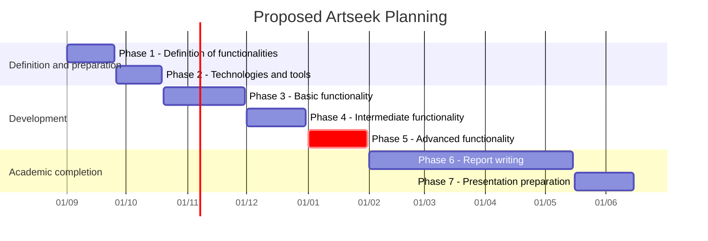

# Methodology

The work will be carried out following an iterative and incremental methodology. First, the functional and technical scope of the application will be defined and, subsequently, the development environment and the necessary tools will be configured.

The functionalities will be implemented progressively across several iterations. Each iteration will incorporate new capabilities on top of the previous version and will end with a functional version of the application.

Phase 1 corresponds to the definition of the functionalities and the initial analysis. Phase 2 will be dedicated to configuring the development technologies and tools, together with the quality controls that will be run periodically.

Phases 3, 4 and 5 will be dedicated to the iterative and incremental development of Artseek. At the end of each of these phases, a new version (**release**) will be published.

Phase 6 will be dedicated to writing the Bachelor's Degree Final Project report, and Phase 7 to preparing the presentation and defense.

## Phases

| Phase | Description | Expected outcome |
| --- | --- | --- |
| 1 | Definition of functionalities | Functionalities, state of the art, screens, analysis, and README. |
| 2 | Configuration of technologies and tools | Prepared repository, development environment, initial tests, and quality controls. |
| 3 | Iterative and incremental development | Release of a first version with the basic functionality. |
| 4 | Iterative and incremental development | Release of a second version with the intermediate functionality and the first AI integration. |
| 5 | Iterative and incremental development | Release of the final version with the advanced functionality and multimodal search. |
| 6 | Report writing | Final Bachelor's Degree Final Project report. |
| 7 | Presentation preparation | Presentation and defense of the project. |

## Dates

The dates will be agreed upon with the supervisor and updated as the project progresses. The latest version, including the advanced and multimodal search algorithm, is planned for January, so that the Bachelor's Degree Final Project focused on deploying the same application can begin at that point.

| Phase | Proposed start | Proposed end |
| --- | --- | --- |
| Phase 1 | `[1/09/2026]` | `[25/09/2026]` |
| Phase 2 | `[26/09/2026]` | `[19/10/2026]` |
| Phase 3 | `[20/10/2026]` | `[30/11/2026]` |
| Phase 4 | `[01/12/2026]` | `[31/12/2026]` |
| Phase 5 | `[01/01/2027]` | `[31/01/2027]` |
| Phase 6 | `[01/02/2027]` | `[15/05/2027]` |
| Phase 7 | `[16/05/2027]` | `[15/06/2027]` |
| Fase 7 | `[16/05/2027]` | `[15/06/2027]` |

## Gantt Chart

Once the final dates have been defined, the different phases will be represented using a Gantt chart.

> **Note:** The dates shown in the diagram are provisional and must be replaced with the actual dates agreed upon for the project.
